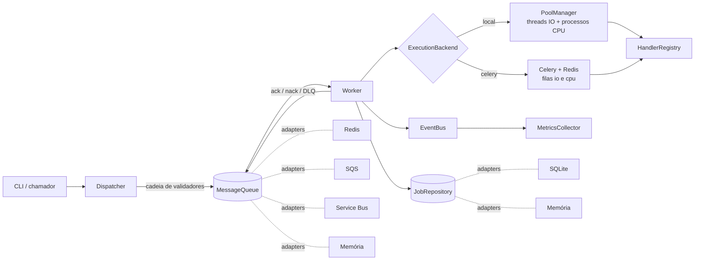
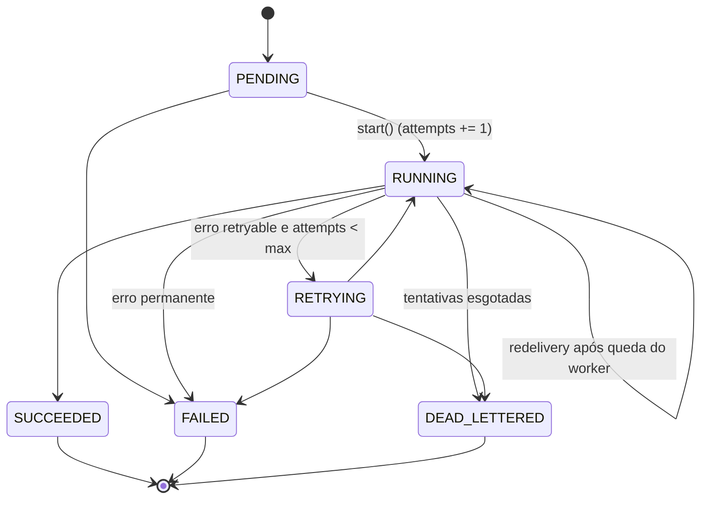

# TaskForge

Plataforma de orquestração de jobs em segundo plano, em Python 3.12+. Os jobs entram por uma fila
(Redis, AWS SQS, Azure Service Bus ou memória), são executados por um worker em threads, processos
ou Celery e têm o estado persistido em um repositório. O núcleo não conhece nenhum fornecedor:
tudo que é externo fica atrás de uma porta (`ports/`) e entra por um adaptador.

[](.github/workflows/ci.yml)


## Sumário

- [Arquitetura](#arquitetura)
- [Máquina de estados do Job](#máquina-de-estados-do-job)
- [Semântica de entrega](#semântica-de-entrega)
- [Modelo de concorrência](#modelo-de-concorrência)
- [Tratamento de erros](#tratamento-de-erros)
- [Padrões de projeto e SOLID](#padrões-de-projeto-e-solid)
- [Adaptadores de fila](#adaptadores-de-fila)
- [Celery](#celery)
- [Infraestrutura como código](#infraestrutura-como-código)
- [DevOps](#devops)
- [Início rápido](#início-rápido)
- [Configuração](#configuração)
- [Como estender](#como-estender)
- [Testes](#testes)
- [Limitações](#limitações)

## Arquitetura

Hexagonal (ports and adapters). `domain/` e `services/` só importam `ports/`; `bootstrap.py` é a
única raiz de composição e a única que conhece as classes concretas.



```
src/taskforge/
├── domain/        Job (imutável), JobMessage (contrato da fila), eventos
├── ports/         Publisher, Consumer, MessageQueue, JobRepository, ExecutionBackend
├── services/      Dispatcher, Worker, cadeia de validação de entrada
├── adapters/
│   ├── queues/        redis_queue, sqs, servicebus, memory, factory
│   └── repositories/  sqlite, memory
├── concurrency/   PoolManager (threads/processos) e backends de execução
├── celery_app/    app, tasks, worker, backend de resultados
├── handlers/      JobHandler, HandlerRegistry, handlers embutidos
├── patterns/      CircuitBreaker, RetryPolicy, EventBus
├── resources.py   context managers
├── exceptions.py  hierarquia com `retryable`
├── config.py      Settings validadas (TASKFORGE_*)
└── bootstrap.py   composição (ExitStack)
```

Duas fontes de verdade com papéis distintos: a **mensagem** na fila é uma ordem de trabalho
(`schema_version`, `job_id`, `handler`, `payload`, `max_attempts`); o **estado** (tentativas,
resultado, erro) vive só no `JobRepository`.

## Máquina de estados do Job

`Job` é um modelo pydantic `frozen`. Cada transição valida contra a tabela abaixo e devolve uma
nova instância via `model_copy`; ninguém muta um `Job` compartilhado entre threads.



Transição fora da tabela levanta `InvalidTransitionError` (um `PermanentError`). Mensagem de erro
persistida é truncada em 2000 caracteres.

## Semântica de entrega

**Pelo menos uma vez.** Não existe exactly-once em SQS, Service Bus ou Redis; o projeto assume isso
e compensa no consumidor.

| Situação | Comportamento do `Worker` |
|---|---|
| Job reaparece já em estado terminal | só `ack` (idempotência), não reexecuta |
| `attempts >= max_attempts` ao receber | dead-letter direto (poison pill: worker caindo em loop) |
| Erro permanente | `FAILED` + `ack` (a mensagem cumpriu seu papel) |
| Erro transitório, ainda há tentativas | `RETRYING` + `nack(requeue=True, delay=backoff)` |
| Erro transitório, tentativas esgotadas | `DEAD_LETTERED` + `nack(requeue=False)` |
| Mensagem inválida (decode, handler inexistente, payload) | rejeitada para a DLQ sem executar |
| Falha em `ack`/`nack` (`QueueError`) | logada e engolida; a fila reentrega |
| Timeout do job | `Future` abandonado, `JobTimeoutError` (transitório), mensagem reentregue |
| Processo filho morreu | `BrokenProcessPool` → `WorkerCrashedError` (transitório) |

O `ack` só acontece **depois** de gravar o estado final no repositório. O `Dispatcher` aceita
`dedup_key` para publicação idempotente onde o broker suporta (Service Bus: `MessageId` + duplicate
detection). Efeito colateral: **todo handler precisa ser idempotente**.

Todo acesso à fila e ao repositório ocorre na thread do worker (clientes de fila nem sempre são
thread-safe). Só o código dos handlers roda em paralelo. Um lote é recebido, todos os jobs são
submetidos sem bloquear e depois cada `Future` é aguardado com o prazo restante.

`visibility_timeout` precisa ser **maior** que `job_timeout`; caso contrário a fila devolve a mensagem
enquanto o job ainda roda e outro worker a executa em paralelo. Não há renovação automática de
lease nesta versão.

## Modelo de concorrência

`concurrency/pools.py` expõe `PoolManager`, que despacha por `ExecutionMode`:

| Modo | Executor | Uso |
|---|---|---|
| `INLINE` | thread do worker | trivial; o erro volta via `Future` |
| `THREAD` | `ThreadPoolExecutor` (`taskforge-io-*`) | I/O: rede, disco, banco (o GIL é liberado na espera) |
| `PROCESS` | `ProcessPoolExecutor`, contexto `spawn` | CPU: cada processo tem seu GIL |

Detalhes que importam:

- **`spawn`, não `fork`.** `fork` em processo multithread pode travar (locks herdados). O custo é
  reimportar o módulo no filho, por isso handlers `PROCESS` precisam estar em módulos listados em
  `TASKFORGE_PLUGINS`.
- **Pool quebrado.** Se um filho morre (OOM, segfault), todo o `ProcessPoolExecutor` fica em
  `BrokenProcessPool`. O manager descarta o pool, recria na submissão seguinte (uma nova tentativa
  na própria submissão) e os jobs afetados voltam como `WorkerCrashedError` retryable.
- **Criação preguiçosa e `Lock`.** Os pools nascem sob demanda, protegidos por lock, e são
  encerrados pelo `__exit__`. `close(wait=False)` cancela futures pendentes.
- `max_tasks_per_child` opcional para conter vazamento de memória em processos longos.
- **Limite conhecido:** uma thread presa em I/O não pode ser morta em Python, só abandonada.

## Tratamento de erros

`exceptions.py` define uma hierarquia onde **o tipo carrega a política de retry**:

```
TaskForgeError                      retryable = False
├── TransientError                  retryable = True
├── PermanentError                  retryable = False
│   ├── InvalidTransitionError
│   ├── JobValidationError
│   │   ├── MessageDecodeError
│   │   └── HandlerNotFoundError
│   └── HandlerError
├── ConfigurationError
└── RepositoryError
    └── RepositoryUnavailableError  (também TransientError)
```

- `is_retryable(exc)` lê o atributo de classe; um novo erro transitório só declara
  `retryable = True`, sem editar nenhum `isinstance` (OCP).
- Construtores aceitam só `message` posicional (mais `context` nomeado). Isso mantém as exceções
  serializáveis com `pickle`, requisito para atravessar `ProcessPoolExecutor` e o backend de
  resultados do Celery. Uma exceção que não sobrevive ao pickle derruba o pool inteiro.
- Resumos de erro do pydantic usam `include_input=False` para não vazar payload sensível em logs.
- `RetryPolicy` (`patterns/retry.py`): backoff exponencial limitado por `max_delay`, com jitter
  simétrico (`±jitter`). `sleep` e `rng` são injetáveis, então os testes são determinísticos e
  instantâneos. Disponível como função (`call_with_retry`) e decorator (`@retry`).
- `CircuitBreaker` (`patterns/circuit_breaker.py`): `CLOSED → OPEN → HALF_OPEN → CLOSED`, thread-safe,
  com `half_open_max_calls` sondas. Erros que não "tripam" (ex.: validação) contam como sucesso;
  `KeyboardInterrupt` e afins não dão veredito. Uso: `with breaker.guard():` ou `@breaker`.

## Padrões de projeto e SOLID

| Tema | Onde |
|---|---|
| **ISP** | `ports/queue.py`: `Publisher` e `Consumer` separados; `MessageQueue` os combina. Quem só publica não depende de `receive`/`ack`, e IAM/RBAC de produtor e worker são concedidos separadamente |
| **DIP** | serviços dependem de `ports/`; a montagem fica em `bootstrap.py` |
| **OCP** | novos backends entram em `QueueFactory`; novos handlers via `HandlerRegistry`; novos erros declarando `retryable` |
| **SRP** | `Dispatcher` (publica), `Worker` (consome), `PoolManager` (executa), `IntakeValidator` (valida) |
| Strategy / Template Method | `handlers/base.py` (`JobHandler`: `validate` + `execute`, `mode`) |
| Registry / Factory | `handlers/registry.py`, `adapters/queues/factory.py` |
| Adapter | `adapters/queues/*` traduzem SDKs para a porta `MessageQueue` |
| Repository | `ports/repository.py`, `adapters/repositories/*` |
| Observer | `patterns/event_bus.py` e `MetricsCollector` (eventos de domínio imutáveis) |
| Chain of Responsibility | validadores de entrada em `services/intake.py` (tamanho antes de decodificar) |
| Circuit Breaker, Retry | `patterns/` |
| Estado imutável | `Job` congelado, transições devolvem cópias |
| Context managers | `resources.py`: `timed`, `suppress_logged`, `ShutdownSignal` (SIGINT/SIGTERM → `Event`, segundo sinal força saída), `bind_job` (`contextvars` para logs), `translate_errors` (SDK → hierarquia própria); `bootstrap.py` usa `ExitStack` para desmontar na ordem inversa |

## Adaptadores de fila

| Adaptador | Mecanismo | Notas |
|---|---|---|
| `memory` | `deque` + estruturas locais | testes e demo; mesmo contrato dos demais |
| `redis` | "reliable queue" com `BLMOVE` | `ready` (list), `processing` (list), `leases` (zset), `delayed` (zset), `deliveries` (hash), `dead` (list). Um *reaper* devolve mensagens de consumidor morto quando o lease expira; ack é transacional (`MULTI`) e falha se o recibo não existe mais |
| `sqs` | `boto3`, long polling | DLQ e redrive no Terraform; `nack` ajusta `VisibilityTimeout` para o backoff; lote máximo 10 (limite do SQS) |
| `servicebus` | `azure-servicebus` | lock token como recibo, dead-letter nativo, duplicate detection via `dedup_key` |

`QueueMessage.receipt` é um token opaco (ReceiptHandle, lock token, envelope), o que mantém a porta
agnóstica. Recursos exclusivos de cada nuvem (sessões do Service Bus, FIFO do SQS) ficam fora dela de
propósito. Para volume alto em Redis, a evolução natural é Streams com consumer groups
(`XREADGROUP`/`XAUTOCLAIM`).

## Celery

Celery é um **backend de execução**, não a fila de intake (a fila continua sendo `MessageQueue`).
Assim a escolha de nuvem não depende dele.

- Filas separadas por natureza da carga: `taskforge.io` (threads/gevent) e `taskforge.cpu` (prefork).
- `task_acks_late` + `task_reject_on_worker_lost`: a task volta à fila se o processo morrer.
- `worker_prefetch_multiplier=1`: distribuição justa de tasks longas.
- Serialização **somente JSON** (`accept_content=["json"]`), sem pickle vindo da rede.
- `task_soft_time_limit = job_timeout`, `task_time_limit = job_timeout + 30`.
- `task_always_eager` configurável: os testes exercitam o caminho Celery sem broker.

## Infraestrutura como código

`infra/terraform/` separa **módulos** (sem provider nem backend) de **ambientes** (com ambos), o que
permite `terraform validate` no CI com `init -backend=false`.

| Módulo | Recursos |
|---|---|
| `aws_queue` | SQS + DLQ com redrive, criptografia, política que exige TLS, IAM de mínimo privilégio separado para produtor e worker, alarmes CloudWatch (SNS) |
| `azure_queue` | namespace + fila do Service Bus com dead-letter, duplicate detection, RBAC de produtor e worker, alerta de métrica |

Os ambientes `envs/aws` e `envs/azure` instanciam os módulos e exportam as variáveis `TASKFORGE_*`
correspondentes. Detalhes e a limitação do SNS sem criptografia (CloudWatch × chave gerenciada) em
[`infra/terraform/README.md`](infra/terraform/README.md) e [`docs/DECISIONS.md`](docs/DECISIONS.md).

## DevOps

| Artefato | O que faz |
|---|---|
| `Dockerfile` | imagem do app; roda sem root |
| `docker-compose.yml` | Redis, worker e workers Celery; perfis `celery` e `aws` (LocalStack) |
| `Makefile` | `install`, `lint`, `typecheck`, `cov`, `check`, `demo`, `up`, `down`, `tf-validate` |
| `.github/workflows/ci.yml` | ruff (lint + format), mypy `--strict`, pytest com cobertura mínima de 90%, `pip-audit`, `terraform fmt/validate` por ambiente, Trivy (IaC e Dockerfile) e smoke test da imagem |
| `.github/dependabot.yml` | atualização de dependências |

Endurecimento do container: usuário não root, sistema de arquivos somente leitura, sem capabilities.
O handler `http.fetch` só aceita destinos que resolvem para IPs públicos e não segue redirecionamentos
(mitigação de SSRF).

## Início rápido

```bash
python -m venv .venv && source .venv/bin/activate   # Windows: .venv\Scripts\activate
make install            # pip install -e ".[dev]"
make demo               # tudo em um processo, sem dependências externas
make check              # ruff, mypy --strict e pytest com cobertura
```

Com Docker (Redis, worker e workers Celery):

```bash
make up
docker compose run --rm worker submit primes.count --payload '{"limit": 2000000}'
docker compose run --rm worker jobs
make down
```

`docker compose --profile celery up` delega a execução ao Celery e
`docker compose --profile aws up` usa LocalStack no lugar do Redis.

CLI:

```bash
taskforge handlers
taskforge submit echo --payload '{"msg": "oi"}'
taskforge worker            # laço contínuo; --once processa um lote
taskforge status <job_id>
taskforge jobs --status failed
taskforge health --max-age 90
```

## Configuração

Variáveis de ambiente com prefixo `TASKFORGE_` (modelo em [`.env.example`](.env.example)). A validação
roda na partida e falha com mensagem clara.

| Variável | Padrão | Descrição |
|---|---|---|
| `QUEUE_BACKEND` | `memory` | `memory`, `redis`, `sqs` ou `servicebus` |
| `EXECUTION_BACKEND` | `local` | `local` (pools) ou `celery` |
| `REDIS_URL` | `redis://localhost:6379/0` | fila Redis e broker Celery |
| `IO_THREADS` / `CPU_PROCESSES` | 16 / CPUs-1 | tamanho dos pools |
| `BATCH_SIZE` | 8 | mensagens por leitura (máximo 10, limite do SQS) |
| `MAX_DELIVERIES` | 5 | entregas antes de ir para a DLQ |
| `JOB_TIMEOUT_SECONDS` | 300 | tempo máximo por job |
| `VISIBILITY_TIMEOUT_SECONDS` | 60 | **deve ser maior que o timeout do job** |
| `DATABASE_PATH` | `taskforge.db` | SQLite do repositório de jobs |
| `PLUGINS` | vazio | módulos com handlers extras, separados por vírgula |

## Como estender

Novo handler:

```python
from collections.abc import Mapping
from typing import Any

from taskforge.domain.models import ExecutionMode
from taskforge.handlers.base import JobHandler
from taskforge.handlers.registry import register_handler


@register_handler
class ResizeImage(JobHandler):
    name = "image.resize"
    mode = ExecutionMode.PROCESS  # CPU: roda em processo separado

    def validate(self, payload: Mapping[str, Any]) -> Mapping[str, Any]:
        ...  # levante JobValidationError se o payload for inválido
        return payload

    def execute(self, payload: Mapping[str, Any]) -> dict[str, Any]: ...
```

Coloque a classe em um módulo e liste-o em `TASKFORGE_PLUGINS`. É obrigatório para handlers `PROCESS`,
porque cada processo filho (`spawn`) importa o módulo por conta própria para registrar o handler.
Handlers devem ser sem estado e idempotentes.

Novo backend de fila: implemente `MessageQueue` (`publish`, `receive`, `ack`, `nack`) e registre na
`QueueFactory`. Os testes de contrato em `tests/` mostram o comportamento esperado.

## Testes

```bash
make check      # ruff + mypy --strict + pytest --cov --cov-fail-under=90
```

261 testes, 96% de cobertura de linhas e branches, `ruff` e `mypy --strict` sem avisos. Cobrem
recuperação de pool de processos quebrado, serialização de exceções entre processos, redelivery,
dead-letter, idempotência, backoff determinístico e o Celery em modo eager. Redis é testado com
`fakeredis`; SQS e Service Bus com clientes simulados.

> **Windows:** `test_shutdown_signal_sets_event_and_restores_handlers` e `test_second_signal_forces_exit`
> usam `os.kill(getpid(), SIGTERM)`, que no Windows termina o processo em vez de entregar o sinal. Rode
> a suíte completa em Linux/WSL/CI.

## Limitações

Dito com franqueza, para ninguém levar o projeto a produção por engano:

- A suíte automatizada usa dublês (`fakeredis`, clientes simulados). Foram verificados manualmente,
  com `docker compose`, o build da imagem, o smoke test (`--version`, `demo`), Redis real com worker
  local, Celery com as filas `io` e `cpu` e SQS contra LocalStack (sucesso, erro permanente e
  transitório até a DLQ). Isso não está automatizado e LocalStack não é a AWS.
- **Não verificados:** Azure Service Bus contra um serviço real ou emulador, e o Terraform
  (`validate`/`plan`/`apply`); ficam a cargo do CI e seu.
- SQLite basta para um único nó. Com vários workers em máquinas diferentes, troque o repositório por
  um banco de rede (a porta `JobRepository` existe para isso).
- Sem renovação de lease/visibilidade durante a execução do job (ver `visibility_timeout`).
- Não há API HTTP nem autenticação; a entrada é a CLI e o `Dispatcher`.
- Não há cancelamento de jobs em execução; o limite é o timeout por job.
